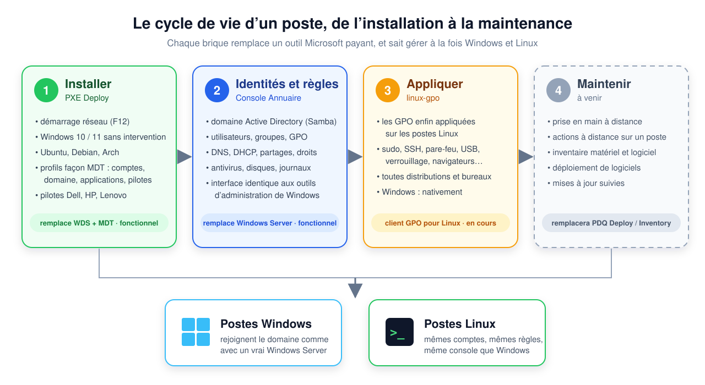
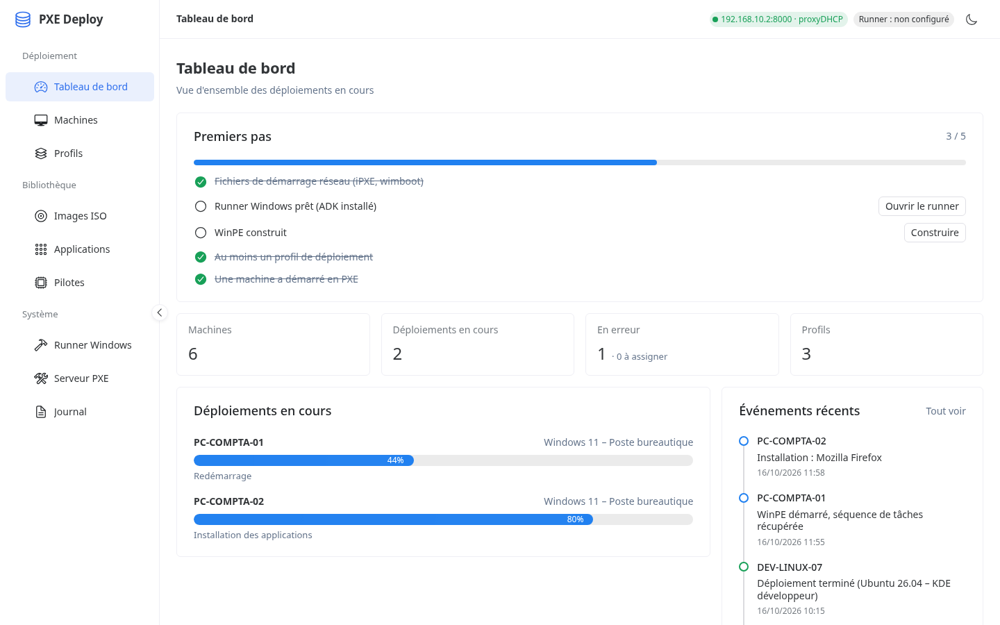
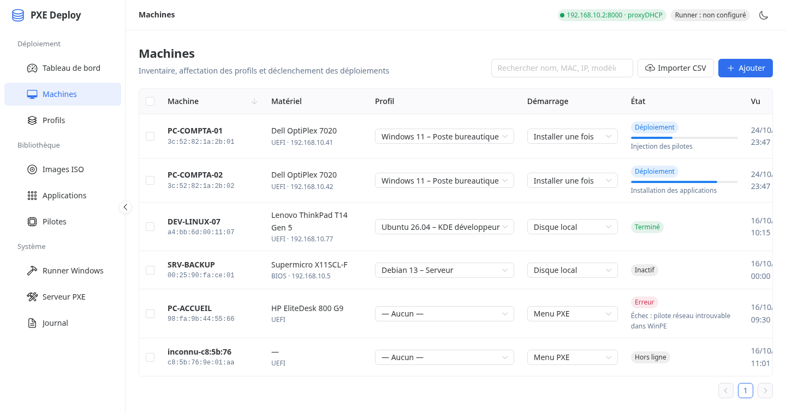
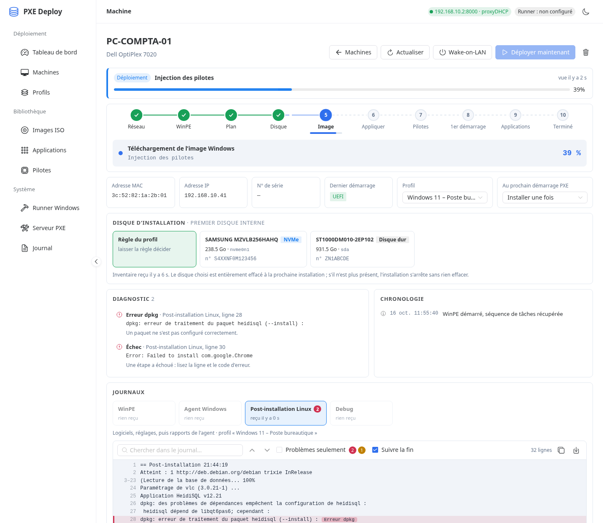
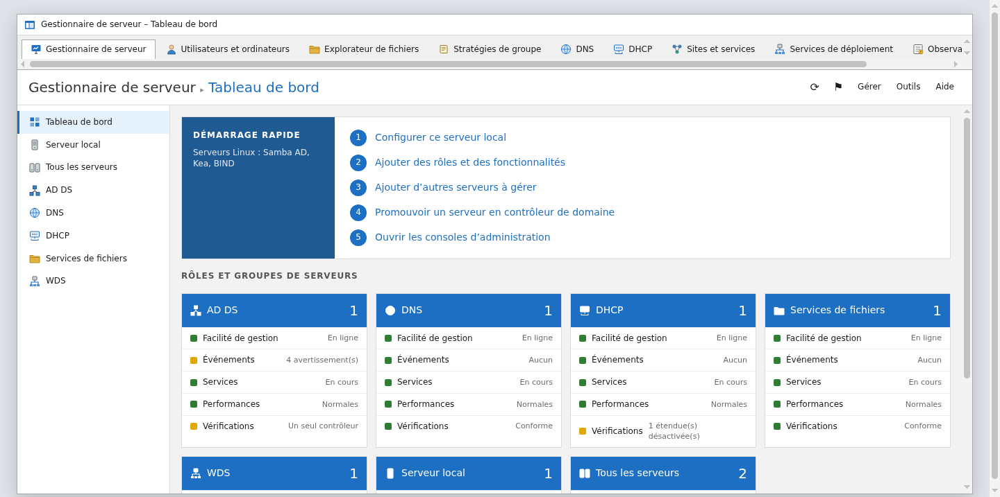
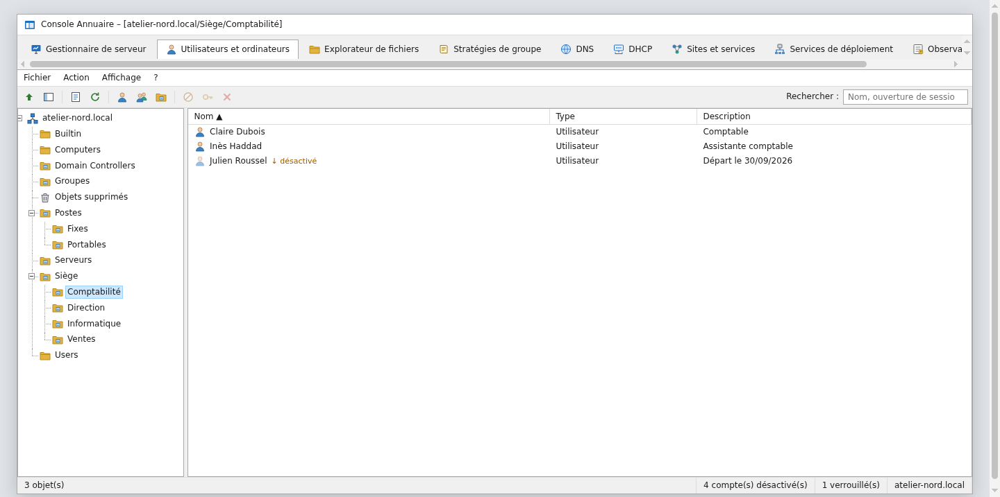
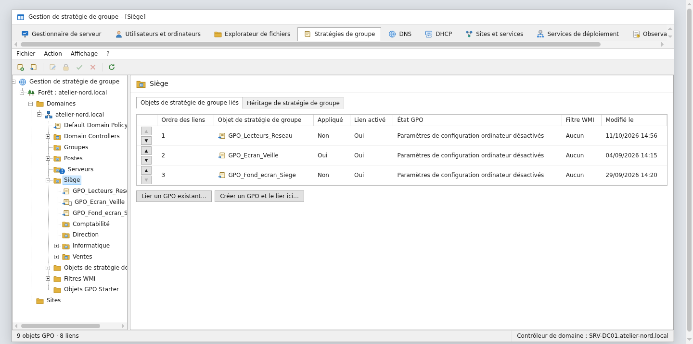
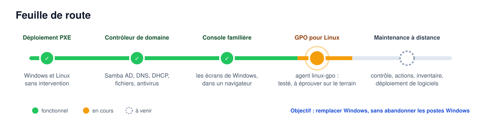

  

  <b>Installer, administrer et maintenir un parc de postes Linux <i>et</i> Windows, 
  avec des outils libres qui ressemblent à ceux de Microsoft — sans aucune licence.</b>

  
  
  
  

---

## L’idée

Dans une entreprise, une école ou une mairie, faire tourner un parc de PC repose presque toujours sur la même pile Microsoft :
**Windows Server** pour les comptes et les règles, **WDS/MDT** pour installer les postes, des outils comme **PDQ Deploy** pour
les maintenir. C’est efficace… et cher, et cela enferme : passer des postes sous Linux veut dire perdre tous ces outils.

**linux-ad-awesome** rassemble des projets qui reconstruisent cette chaîne avec des logiciels libres, en gardant ce qui marche :

- **les mêmes écrans** — un administrateur Windows retrouve ses consoles habituelles, il n’a rien à réapprendre ;
- **les mêmes protocoles** — Active Directory, GPO, PXE : les postes **Windows** continuent de fonctionner normalement ;
- **les postes Linux deviennent des citoyens de première classe** — mêmes comptes, mêmes règles, même console.

L’objectif à terme : **pouvoir remplacer complètement Windows**, sans jamais obliger à abandonner les postes Windows qui restent.

  

## Les projets

| | Projet | Rôle | Remplace | État |
|:-:|---|---|---|:-:|
| ① | **[PXE Deploy](https://github.com/jonathan-pp/pxe-deploy)** | installer Windows ou Linux par le réseau, tout seul | WDS + MDT | 🟢 fonctionnel |
| ② | **[Console Annuaire](https://github.com/jonathan-pp/linux-AD)** | serveur de domaine, DNS, DHCP, fichiers, antivirus, GPO — dans une interface façon Windows | Windows Server + ses consoles | 🟢 fonctionnel |
| ③ | **[linux-gpo](https://github.com/jonathan-pp/linux-gpo-agent)** | appliquer les stratégies de groupe sur les postes Linux | le client GPO de Windows | 🟠 en cours |
| ④ | **Portail Support** (dans la Console Annuaire) | inventaire des postes, déployer des logiciels, agir à distance, tickets, avec trois niveaux de techniciens | PDQ Deploy / Inventory, assistance à distance | 🟠 en test |

> PXE Deploy et la Console Annuaire sont encore en dépôt privé le temps de les finaliser ; linux-gpo est déjà public.

---

### ① PXE Deploy — installer un poste en appuyant sur F12

Une machine démarre sur le réseau, reçoit le système prévu pour elle et s’installe seule, de l’effacement du disque jusqu’aux
applications. Des **profils** à la façon de MDT décrivent chaque type de poste : système, comptes, domaine, applications,
pilotes, nettoyage de Windows.

- **Windows 10 / 11** sans intervention (WinPE, DISM, fichier de réponses, agent de première ouverture de session) ;
- **Ubuntu, Debian, Arch** avec l’installateur officiel de chaque distribution ;
- pilotes **Dell, HP, Lenovo** téléchargés pour chaque modèle du parc et injectés automatiquement ;
- suivi en direct de chaque machine, journaux et diagnostic des erreurs.

<table>
  <tr>
    <td width="50%"></td>
    <td width="50%"></td>
  </tr>
  <tr>
    <td align="center">Tableau de bord : déploiements en cours</td>
    <td align="center">Machines : profil et mode de démarrage de chaque poste</td>
  </tr>
</table>

 
Suivi d’une installation Windows, étape par étape, avec le diagnostic des journaux

### ② Console Annuaire — Windows Server, sans Windows Server

Un serveur **Debian** avec **Samba** fait contrôleur de domaine Active Directory : les postes Windows le rejoignent comme un vrai
Windows Server. L’administration se fait dans un navigateur, avec des écrans qui reprennent ceux de Windows : *Gestionnaire de
serveur*, *Utilisateurs et ordinateurs*, *Gestion des stratégies de groupe*, *DNS*, *DHCP*, *Observateur d’événements*.

- comptes, groupes, unités d’organisation, corbeille, mots de passe LAPS et clés BitLocker ;
- **près de 200 paramètres de GPO** prêts à cocher, pour Windows **et** pour Linux ;
- partages de fichiers avec droits NTFS et **antivirus** (ClamAV) ;
- DNS, DHCP, disques, services, journaux d’audit.

<table>
  <tr>
    <td width="50%"></td>
    <td width="50%"></td>
  </tr>
  <tr>
    <td align="center">Gestionnaire de serveur</td>
    <td align="center">Utilisateurs et ordinateurs</td>
  </tr>
</table>

 
Gestion des stratégies de groupe (données de démonstration)

### ③ linux-gpo — les GPO enfin appliquées sur Linux

Les postes Linux savent rejoindre un domaine, mais ignorent les stratégies de groupe. **linux-gpo** est un agent léger, sans
dépendance, qui les lit exactement comme Windows (ordre d’application, blocage d’héritage, filtrage de sécurité) et les traduit
pour Linux : `sudo`, SSH, pare-feu, qui peut se connecter, verrouillage du bureau, clés USB, navigateurs, mises à jour, logiciels,
scripts, lecteurs réseau…

- **toutes les distributions** (Debian, Ubuntu, Mint, Arch, Fedora, openSUSE, NixOS) et **tous les bureaux** (GNOME, KDE, Cinnamon, MATE) ;
- fonctionne avec **Windows Server comme avec Samba**, sur des postes joints avec sssd ou winbind ;
- réglable depuis la Console Annuaire ou depuis la console GPO de Windows (modèles ADMX fournis) ;
- un réglage retiré de la GPO est retiré du poste.

<table>
  <tr>
    <td width="50%"></td>
    <td width="50%"></td>
  </tr>
  <tr>
    <td align="center"><code>linux-gpo diagnostic</code> : le poste et son domaine</td>
    <td align="center"><code>linux-gpo resultat</code> : l’équivalent de <code>gpresult</code></td>
  </tr>
</table>

### ④ Maintenir les postes à distance

La dernière brique pour se passer des outils payants existe maintenant dans la Console Annuaire, sous forme d’un portail pour les techniciens, avec des droits par niveau (assistance, technicien, administrateur du support) et par unité d’organisation :

- **inventaire** matériel et logiciel du parc, avec des collections qui se mettent à jour toutes seules ;
- **déploiement** d’applications et de lots depuis la bibliothèque de PXE Deploy, désinstallation, mises à jour, antivirus, redémarrage ;
- **actions à distance** : commande ou script, programmes lancés, services, message à l’utilisateur ;
- **prise en main** d’un poste Windows avec ou sans l’accord de l’utilisateur ;
- **tickets** et fiches « comment faire ».

Un agent léger (Windows et Linux) s’installe sur chaque poste, par une stratégie de groupe pour les postes du domaine. Il n’accepte que le certificat du serveur. L’agent Windows reste à éprouver sur de vrais postes.

---

## Ce qui remplace quoi

| Besoin | Chez Microsoft | Ici |
|---|---|---|
| Installer les postes par le réseau | WDS + MDT | PXE Deploy |
| Comptes, groupes, ouverture de session | Active Directory (Windows Server) | Samba AD + Console Annuaire |
| Consoles d’administration | RSAT, GPMC, DNS, DHCP… | Console Annuaire (navigateur) |
| Règles appliquées aux postes Windows | GPO | GPO (inchangées) |
| Règles appliquées aux postes Linux | — | linux-gpo |
| Partages de fichiers et antivirus | Serveur de fichiers + Defender | Samba + ClamAV |
| Maintenance à distance, inventaire | PDQ Deploy / Inventory, Quick Assist | Portail Support (en test) |
| **Licences** | Windows Server + CAL par utilisateur ou appareil | **aucune** |

## Feuille de route

  

## Pour qui ?

- les **PME, écoles, associations, collectivités** qui veulent réduire leur dépendance aux licences ;
- les équipes informatiques qui veulent **essayer Linux sur une partie du parc** sans changer leurs habitudes ;
- celles et ceux qui veulent **apprendre l’administration Active Directory** sans acheter de licence.

## Suivre et contribuer

Les projets avancent pas à pas : chaque brique est testée sur un vrai domaine avant d’être publiée. Les retours, idées et
signalements sont les bienvenus dans les *issues* de chaque dépôt.

Les captures d’écran utilisent des données de démonstration (domaine, machines et personnes fictifs).

